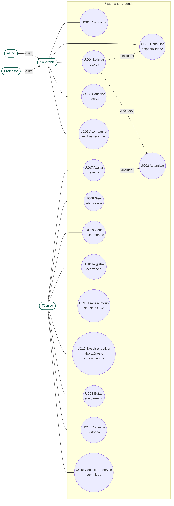
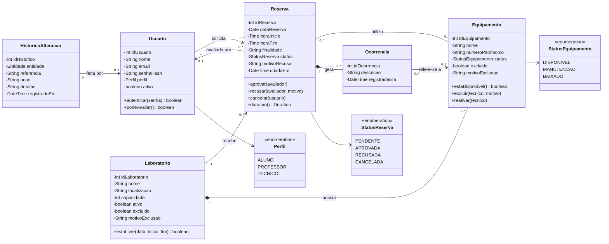
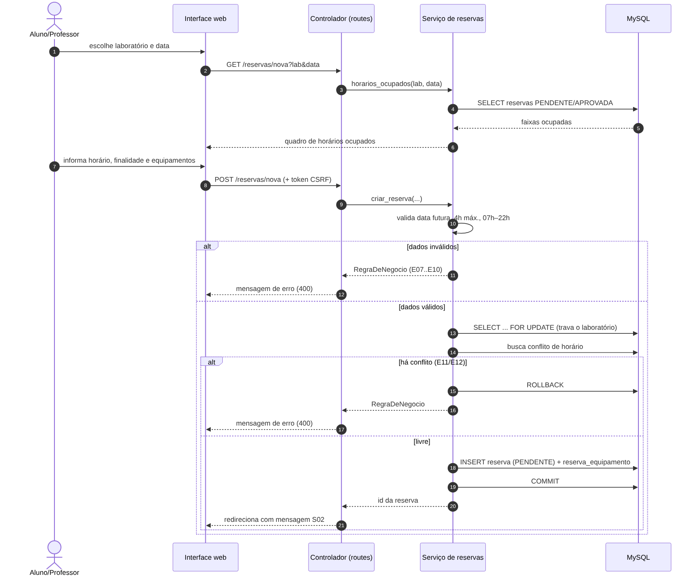
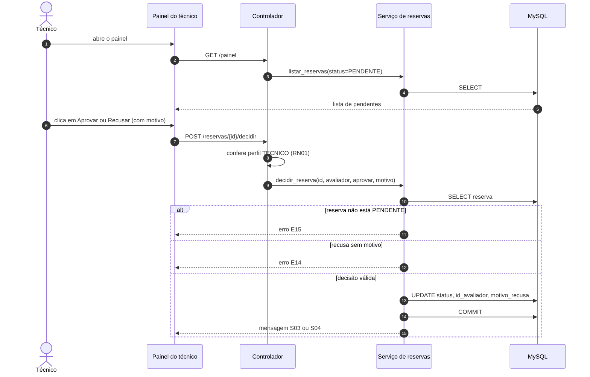
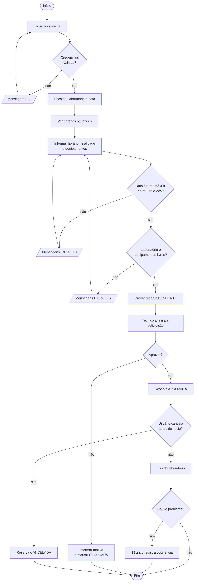
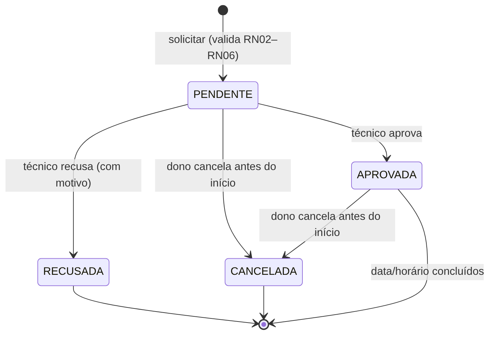
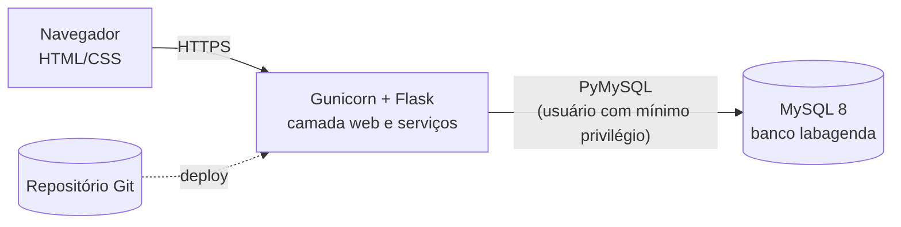

# 2. Modelagem UML revisada

Fontes dos diagramas em `docs/diagramas/*.mmd` (Mermaid). As imagens são geradas com `mmdc`.

## 2.1 Casos de uso

**Ajustes feitos:** (v2.1 e v2.2) entraram os casos de uso UC12 (excluir e reativar), UC13 (editar equipamento), UC14 (consultar histórico) e UC15 (consultar reservas com filtros), todos do técnico, e UC11 passou a incluir o CSV. "Aluno" e "Professor" passaram a herdar de um ator genérico **Solicitante**, já que têm as
mesmas permissões (menos setas, modelo mais fiel). A autenticação (UC02) ficou como `«include»` dos casos de uso
que exigem sessão. A recusa com motivo foi tratada como regra de UC07, não como extensão de UC04, pois não faz
parte do fluxo do solicitante.

### Descrição resumida dos casos de uso principais
| UC04 – Solicitar reserva | |
|---|---|
| Ator | Solicitante (aluno ou professor) |
| Pré-condição | Usuário autenticado; laboratório ativo |
| Fluxo principal | 1. Escolhe laboratório e data. 2. Sistema mostra horários ocupados. 3. Informa horário, finalidade e equipamentos. 4. Sistema valida regras RN02–RN06. 5. Sistema grava a reserva como PENDENTE e exibe S02. |
| Fluxos alternativos | A1. Data passada → E07. A2. Fim ≤ início → E08. A3. Mais de 4 h → E09. A4. Fora de 07–22 h → E10. A5. Conflito de laboratório → E11. A6. Equipamento indisponível → E12. |
| Pós-condição | Reserva PENDENTE visível ao solicitante e ao técnico |

| UC07 – Avaliar reserva | |
|---|---|
| Ator | Técnico |
| Pré-condição | Existe reserva PENDENTE |
| Fluxo principal | 1. Abre o painel. 2. Escolhe uma reserva. 3. Aprova (S03) ou recusa informando motivo (S04). |
| Alternativos | A1. Recusa sem motivo → E14. A2. Reserva já decidida por outra pessoa → E15. |
| Pós-condição | Status APROVADA ou RECUSADA e avaliador registrado |

| UC10 – Registrar ocorrência (v2.2 e v2.2.1) | |
|---|---|
| Ator | Técnico |
| Pré-condição | Reserva APROVADA cujo horário já começou (RN09) |
| Fluxo principal | 1. Escolhe a reserva. 2. Em "O que foi afetado?", escolhe um dos equipamentos da reserva ou "Problema geral do laboratório". 3. Descreve o que aconteceu e, se houver equipamento, pode marcar "colocar em manutenção". 4. Sistema grava a ocorrência (S08) e, se pedido, muda o equipamento para Em manutenção e registra no histórico (S15). |
| Alternativos | A1. Reserva futura ou não aprovada → E22. A2. Manutenção sem equipamento → E31. |
| Pós-condição | Ocorrência registrada; equipamento em manutenção quando solicitado |

| UC12 – Excluir e reativar itens (v2.1) | |
|---|---|
| Ator | Técnico |
| Pré-condição | Laboratório ou equipamento cadastrado |
| Fluxo principal | 1. Escolhe Excluir em um laboratório ou equipamento. 2. Informa o motivo (5+ caracteres); no laboratório, escolhe se os equipamentos saem junto. 3. Sistema marca o item como excluído, guardando data, responsável e motivo (S10, S11). 4. Em Itens excluídos, o técnico pode Reativar (S12, S13). |
| Alternativos | A1. Sem motivo → E26. A2. Laboratório com reservas futuras → E27; equipamento com reservas futuras → E28. A3. Reativar equipamento cujo laboratório está excluído → E29. |
| Pós-condição | Item fora das listas e das telas de reserva; histórico de reservas, ocorrências e relatório preservado |

## 2.2 Diagrama de classes

**Ajustes feitos:** (1) Reserva ↔ Equipamento passou a ser N:N; (2) criada a classe **Ocorrencia**, ligada à
reserva por composição (sem reserva, não existe ocorrência); (3) a associação "avaliada por" aparece
separada de "solicita" porque o avaliador é outro usuário (técnico); (4) situações viraram enumerações; (5) o
atributo `senhaHash` substitui `senha`, refletindo que o sistema nunca guarda a senha original; (6) operações de
negócio (`aprovar`, `recusar`, `cancelar`, `estaLivre`) foram acrescentadas às classes responsáveis;
(7) na v2.1, `Laboratorio` e `Equipamento` ganharam os atributos de exclusão lógica (`excluido`, `motivoExclusao`) e as operações `excluir` e `reativar`; (8) na v2.2, a classe **HistoricoAlteracao** registra quem alterou cada laboratório ou equipamento e o que mudou.

## 2.3 Diagramas de sequência
### Solicitar reserva

### Avaliar reserva

## 2.4 Diagrama de atividades

## 2.5 Diagrama de estados da Reserva

## 2.6 Arquitetura de implantação

O diagrama mostra a implantação real: navegador → **Render** (Gunicorn + Flask) → **MySQL 8 no Aiven** por SSL, com código no **GitHub** e deploy automático a cada `push`.
A aplicação segue três camadas simples: **rotas** (`app/routes.py`, controle e perfis), **serviços**
(`app/services.py`, regras de negócio) e **dados** (`app/db.py`, acesso ao MySQL).

## 2.7 Rastreabilidade
| Caso de uso | Rotas | Função de serviço | Tabelas |
|---|---|---|---|
| UC01 | `/cadastro` | `criar_usuario` | usuario |
| UC02 | `/login`, `/sair` | `autenticar` | usuario |
| UC03 | `/reservas/nova` (GET) | `horarios_ocupados` | reserva |
| UC04 | `/reservas/nova` (POST) | `criar_reserva` | reserva, reserva_equipamento |
| UC05 | `/reservas/<id>/cancelar` | `cancelar_reserva` | reserva |
| UC06 | `/painel` | `listar_reservas` | reserva |
| UC07 | `/reservas/<id>/decidir` | `decidir_reserva` | reserva |
| UC08 | `/laboratorios` | `salvar_laboratorio` | laboratorio, historico_alteracao |
| UC09 | `/equipamentos` | `salvar_equipamento`, `alterar_status_equipamento`, `filtrar_equipamentos` | equipamento, historico_alteracao |
| UC10 | `/ocorrencias` | `registrar_ocorrencia`, `equipamentos_das_reservas` | ocorrencia, equipamento, historico_alteracao |
| UC11 | `/relatorio`, `/relatorio.csv` | `relatorio_uso` | reserva, laboratorio |
| UC12 | `/equipamentos/<id>/excluir`, `/laboratorios/<id>/excluir`, `/excluidos` | `excluir_equipamento`, `excluir_laboratorio`, `listar_excluidos`, `reativar_equipamento`, `reativar_laboratorio` | laboratorio, equipamento, historico_alteracao |
| UC13 | `/equipamentos/<id>/editar` | `editar_equipamento` | equipamento, historico_alteracao |
| UC14 | `/historico` | `listar_historico` | historico_alteracao |
| UC15 | `/reservas` | `buscar_reservas` | reserva, laboratorio, usuario |
