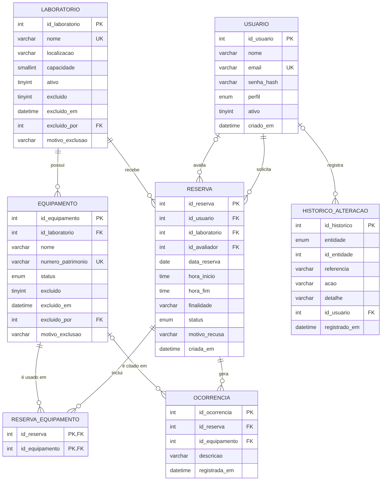

# 4. Projeto de dados

## 4.1 Projeto conceitual (DER)


| Relacionamento | Cardinalidade | Observação |
|---|---|---|
| Usuário solicita Reserva | 1:N | Todo pedido tem um solicitante |
| Usuário avalia Reserva | 1:N opcional | Preenchido quando o técnico decide |
| Laboratório recebe Reserva | 1:N | |
| Laboratório possui Equipamento | 1:N | Equipamento pertence a um único laboratório |
| Reserva utiliza Equipamento | N:N | Resolvida por `reserva_equipamento` |
| Reserva gera Ocorrência | 1:N | Ocorrência não existe sem reserva |
| Equipamento citado em Ocorrência | 1:N opcional | Nem toda ocorrência envolve um equipamento |

## 4.2 Projeto lógico e normalização
Ponto de partida (tabela única, como uma planilha):

`RESERVA_BRUTA(id_reserva, data, hora_ini, hora_fim, finalidade, status, nome_usuario, email_usuario, perfil_usuario, nome_lab, local_lab, capacidade_lab, equipamentos, patrimonios, nome_avaliador)`

**1ª Forma Normal** – `equipamentos` e `patrimonios` guardavam listas ("Switch, Roteador"). Cada valor passa a ocupar
uma linha, com chave composta `(id_reserva, id_equipamento)`.

**2ª Forma Normal** – com chave composta, surgem dependências parciais: data, horário, finalidade e status dependem
só de `id_reserva`; nome e patrimônio do equipamento dependem só de `id_equipamento`. Separam-se
`reserva`, `equipamento` e a associativa `reserva_equipamento`.

**3ª Forma Normal** – dependências transitivas: `id_usuario → nome, e-mail, perfil` e
`id_laboratorio → nome, localização, capacidade`. Criam-se `usuario` e `laboratorio`; o avaliador passa a ser uma
chave estrangeira para `usuario`, evitando a repetição do nome. A entidade `ocorrencia` nasce da necessidade de
registrar vários eventos por reserva sem repetir a reserva.

Resultado (chaves primárias sublinhadas por `PK`, estrangeiras por `FK`):

```
usuario(PK id_usuario, nome, email UK, senha_hash, perfil, ativo, criado_em)
laboratorio(PK id_laboratorio, nome UK, localizacao, capacidade, ativo)
equipamento(PK id_equipamento, FK id_laboratorio, nome, numero_patrimonio UK, status)
reserva(PK id_reserva, FK id_usuario, FK id_laboratorio, FK id_avaliador, data_reserva,
        hora_inicio, hora_fim, finalidade, status, motivo_recusa, criada_em)
reserva_equipamento(PK/FK id_reserva, PK/FK id_equipamento)
ocorrencia(PK id_ocorrencia, FK id_reserva, FK id_equipamento, descricao, registrada_em)
```
Todas as tabelas estão em 3FN: nenhum atributo não-chave depende de outro atributo não-chave.

**Decisões**
- `status` e `perfil` como `ENUM` (conjunto pequeno e estável).
- `motivo_recusa` e `id_avaliador` aceitam `NULL` (só existem após a decisão).
- Exclusão física é evitada: laboratórios e usuários são **desativados** (`ativo = 0`), preservando o histórico.
- Chaves substitutas (`INT AUTO_INCREMENT`) nas tabelas principais; patrimônio e e-mail ficam como únicos.

## 4.3 Projeto físico
Script completo: [`database/schema.sql`](../database/schema.sql) (MySQL 8.0+, InnoDB, `utf8mb4`).

Destaques:
| Recurso | Finalidade |
|---|---|
| `CHECK (hora_fim > hora_inicio)`, `CHECK (capacidade > 0)` | Integridade no banco, mesmo se a aplicação falhar |
| `UNIQUE` em e-mail, nome do laboratório e patrimônio | Evitar duplicidades |
| `FOREIGN KEY … ON DELETE RESTRICT` | Impedir apagar quem tem reservas |
| `ON DELETE CASCADE` em `reserva_equipamento` e `ocorrencia` | Dependentes não ficam órfãos |
| Índice `idx_reserva_lab_data (id_laboratorio, data_reserva, hora_inicio)` | Consulta de conflito (RN05) |
| Índices em `id_usuario`, `status` e `id_equipamento` | Listagens do painel e relatórios |
| Visão `vw_uso_laboratorio` | Base para relatórios gerenciais direto no SGBD |
| Usuário `labagenda_app` com `SELECT, INSERT, UPDATE` | Mínimo privilégio (RNF03) |

**Por que MySQL?** É um dos SGBD relacionais mais usados do mercado, gratuito, com ampla documentação,
suporte nativo em praticamente todo provedor de hospedagem e ferramentas de administração maduras.

### Como criar o banco
**MySQL local com permissão total:**
```bash
mysql -u root -p < database/schema.sql      # cria banco, tabelas, visão e usuário da aplicação
mysql -u root -p < database/seed.sql        # laboratórios e equipamentos de exemplo
python -m app.seed                          # usuários de demonstração (senhas com hash)
```
**MySQL em nuvem (Aiven, usado na entrega):** o provedor já cria o banco `defaultdb` e o usuário administrador e não permite `CREATE DATABASE`/`CREATE USER`. Com as variáveis `DB_*` e `DB_SSL_CA` definidas (ver `docs/06-git-e-implantacao.md`):
```powershell
python database/aplicar_schema.py database/schema.sql   # ignora comandos não permitidos
python -m app.seed
```

### Rotina de backup sugerida
```bash
mysqldump --single-transaction -u root -p labagenda | gzip > backup_$(date +%F).sql.gz
# Banco em nuvem: acrescentar --ssl-ca=database/ca.pem -h HOST -P PORTA
```

## 4.4 Dicionário de dados
Veja [`database/dicionario_dados.md`](../database/dicionario_dados.md).

## 4.5 Consultas de apoio (exemplos)
```sql
-- Horários ocupados de um laboratório em uma data
SELECT hora_inicio, hora_fim, status
FROM reserva
WHERE id_laboratorio = 1 AND data_reserva = '2026-11-03'
  AND status IN ('PENDENTE','APROVADA')
ORDER BY hora_inicio;

-- Horas de uso por laboratório no mês
SELECT laboratorio, SUM(horas_uso) AS horas
FROM vw_uso_laboratorio
WHERE data_reserva BETWEEN '2026-11-01' AND '2026-11-30'
GROUP BY laboratorio ORDER BY horas DESC;

-- Equipamentos com mais ocorrências
SELECT e.nome, COUNT(*) AS total
FROM ocorrencia o JOIN equipamento e ON e.id_equipamento = o.id_equipamento
GROUP BY e.id_equipamento, e.nome ORDER BY total DESC;
```
