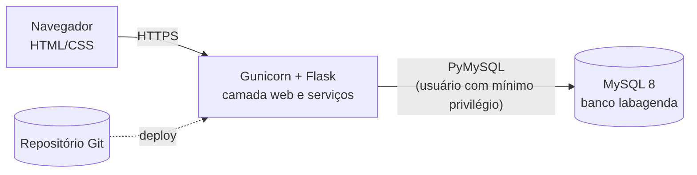

# 6. Git, execução local e implantação

**Repositório (código aberto):** https://github.com/LeonardoCeccon/Projeto-Integrador-Interdisciplinar
**Solução em funcionamento:** https://projeto-integrador-interdisciplinar.onrender.com

## 6.1 Estrutura do repositório
```
Projeto-Integrador-Interdisciplinar/
├── README.md · CHANGELOG.md · requirements.txt · .gitignore · .env.example
├── app/                 código Flask (rotas, serviços, acesso a dados, templates, CSS)
├── database/            schema.sql (MySQL), schema_hospedado.sql, seed.sql, schema_sqlite.sql (testes),
│                        migracao_2_1.sql e migracao_2_2.sql (bancos já existentes),
│                        aplicar_schema.py, ca.pem (certificado público do Aiven), dicionario_dados.md
├── docs/                escopo, UML, IHC, dados, testes/laudo, implantação, imagens e fontes dos diagramas
└── tests/               78 testes automatizados
```

## 6.2 Fluxo de trabalho com Git
- Ramo `main` sempre estável; cada correção ou melhoria vira um commit pequeno, no imperativo
  (`Remove espaços das credenciais do banco`).
- Documentação e código mudam **no mesmo commit** quando uma regra muda.
- Cada comentário de colega vira um item do quadro Kaizen (`docs/01-escopo.md`, seção 1.9) e uma linha do `CHANGELOG.md`.
- O deploy é **automático**: todo `git push` na `main` dispara uma nova publicação no Render.
- Nunca versionar senhas, `.env` nem a pasta `.venv`. O `ca.pem` é público e pode ser versionado.

```powershell
git status
git add caminho/do/arquivo
git commit -m "Mensagem clara no imperativo"
git push
```

## 6.3 Execução local (Windows, passo a passo)
1. Instalar o **Python 3** em python.org/downloads, marcando **"Add python.exe to PATH"**, e o **Git** em git-scm.com. Reabrir o VS Code depois.
2. Abrir a pasta do projeto no VS Code (a que contém `app` e `requirements.txt`) e um terminal novo.
3. Criar o ambiente e instalar as dependências:
```powershell
python -m venv .venv
Set-ExecutionPolicy -Scope Process Bypass      # libera scripts só nesta janela
.venv\Scripts\Activate.ps1
pip install -r requirements.txt
```
4. **Modo rápido (SQLite, sem MySQL)** – apenas para ver o sistema funcionando:
```powershell
$env:DB_ENGINE="sqlite"
python -c "from app import db; db.init_sqlite('labagenda_dev.sqlite3','database/schema_sqlite.sql')"
python -m app.seed
flask --app app run          # http://127.0.0.1:5000
```
5. **Modo MySQL** (local ou em nuvem): definir as variáveis da seção 6.4, criar as tabelas e rodar a carga inicial:
```powershell
python database/aplicar_schema.py database/schema.sql
python -m app.seed
flask --app app run
```
`aplicar_schema.py` ignora os comandos que bancos em nuvem não permitem (`CREATE DATABASE`, `CREATE USER`, `GRANT`, `USE`) e roda as tabelas, índices e a visão. Em um MySQL local com permissão total também é possível usar `mysql -u root -p < database/schema.sql`.

Usuários de demonstração (**trocar ou remover antes de uso real**):

| Perfil | E-mail | Senha |
|---|---|---|
| Técnico | tecnico@labagenda.test | Tecnico123 |
| Professor | professor@labagenda.test | Professor123 |
| Aluno | aluno@labagenda.test | Aluno1234 |

## 6.4 Variáveis de ambiente
| Variável | Função |
|---|---|
| `DB_ENGINE` | `mysql` (produção) ou `sqlite` (teste rápido) |
| `DB_HOST`, `DB_PORT`, `DB_NAME` | Endereço, porta e nome do banco |
| `DB_USER`, `DB_PASSWORD` | Credenciais do banco (espaços nas pontas são removidos) |
| `DB_SSL_CA` | Caminho do certificado CA, obrigatório em bancos de nuvem (`database/ca.pem`) |
| `SECRET_KEY` | Chave de assinatura da sessão (texto longo e aleatório) |
| `SECURE_COOKIES` | `1` em produção com HTTPS |
| `PYTHON_VERSION` | Versão do Python usada no Render (3.12.8) |

No Windows PowerShell: `$env:NOME="valor"`. Essas variáveis valem só para a janela de terminal aberta.

## 6.5 Implantação em nuvem (como foi feita)
**Arquitetura:** o navegador acessa o **Render** (Gunicorn + Flask); o Render conecta por SSL ao **MySQL 8 do Aiven**.
O código vem do **GitHub** e é publicado automaticamente.



### Banco de dados (Aiven)
1. Serviço **MySQL** no plano **Free**, banco `defaultdb`, usuário administrador `avnadmin`.
2. Anotados host, porta (diferente de 3306), usuário, senha e o certificado **CA** (`ca.pem`, salvo em `database/ca.pem`).
3. Tabelas criadas a partir do computador com `database/aplicar_schema.py` (na implantação da v2.0: 13 comandos, 6 tabelas, 6 índices e 1 visão). As versões 2.1 e 2.2 acrescentaram colunas e a tabela `historico_alteracao` por migração (veja "Como publicar uma nova versão").
4. Carga inicial com `python -m app.seed` (3 laboratórios, 6 equipamentos, 3 usuários).

### Aplicação (Render)
1. **New → Web Service**, repositório do GitHub, branch `main`, plano Free.
2. **Build Command:** `pip install -r requirements.txt` · **Start Command:** `gunicorn "app:create_app()"`.
3. Variáveis da seção 6.4 cadastradas em **Environment**; depois, **Manual Deploy → Deploy latest commit**.
4. URL pública: https://projeto-integrador-interdisciplinar.onrender.com

### Como publicar uma nova versão
Quando a versão muda o banco (como a 2.1 e a 2.2), a ordem importa: **primeiro o banco, depois o código.**
1. Definir as variáveis `DB_*` e `DB_SSL_CA` no terminal (nunca no código).
2. Aplicar as migrações que faltam, na ordem: `python database/aplicar_schema.py database/migracao_2_1.sql` e depois `migracao_2_2.sql`.
3. `git add`, `git commit`, `git push`. O Render publica sozinho.
4. Conferir no site o rodapé com a versão (v2.2.1) e abrir as telas novas (Itens excluídos, Histórico, Reservas).

Se o código novo subir antes da migração, as telas novas falham por falta de coluna ou tabela.

### Problemas encontrados e como foram resolvidos
| Sintoma nos Logs | Causa | Solução |
|---|---|---|
| `ConnectionRefusedError: [Errno 111]` ao conectar | Variáveis de ambiente vazias: o sistema usou o padrão `127.0.0.1:3306` | Cadastrar as variáveis em *Environment* e refazer o deploy |
| Log mostrava `python3.14` apesar de `PYTHON_VERSION=3.12.8` | Mesma causa: variáveis não aplicadas | Idem; o log passou a mostrar `python3.12` |
| `OperationalError 1045 Access denied for user 'avnadmin'` | Senha gravada com caracteres invisíveis na importação em lote | Recriar `DB_PASSWORD` sozinha e adicionar `.strip()` às credenciais em `app/__init__.py` |
| `fatal: not a git repository` | Terminal aberto na pasta de fora do projeto | Entrar na pasta que contém `.git` antes dos comandos |
| `git push` rejeitado / históricos diferentes | Repositório criado pelo site e pasta local com outro histórico | Criar histórico novo (`git checkout --orphan`) e enviar para o repositório vazio |
| Scripts bloqueados no PowerShell | Política de execução do Windows | `Set-ExecutionPolicy -Scope Process Bypass` |
| `python` não reconhecido | Python fora do PATH | Reinstalar marcando *Add python.exe to PATH* e reabrir o VS Code |

### Cuidados de operação
- **Plano gratuito do Render:** o serviço "dorme" quando fica sem uso; a primeira página pode levar cerca de um minuto. Abrir a URL antes de apresentar.
- **Segurança:** a conta `avnadmin` é administradora; em um sistema real criar um usuário só com `SELECT, INSERT, UPDATE`, como no fim do `schema.sql`. Trocar ou remover as contas de demonstração.
- **Backup:**
```bash
mysqldump --ssl-ca=database/ca.pem --single-transaction -h HOST -P PORTA -u USUARIO -p NOME_DO_BANCO | gzip > backup_$(date +%F).sql.gz
```
- **Alternativas de hospedagem:** Railway (app e banco juntos, normalmente pago) ou VPS própria com Nginx e HTTPS. O PythonAnywhere não oferece MySQL em contas gratuitas criadas depois de 15/01/2026.
