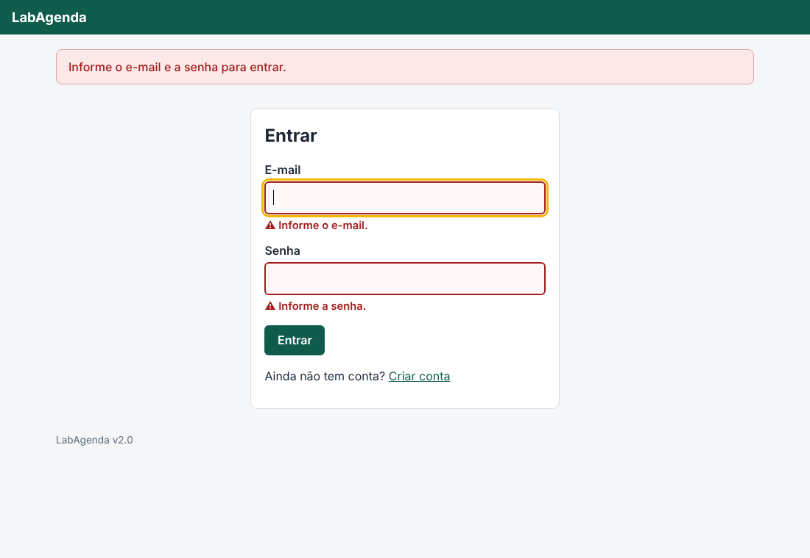
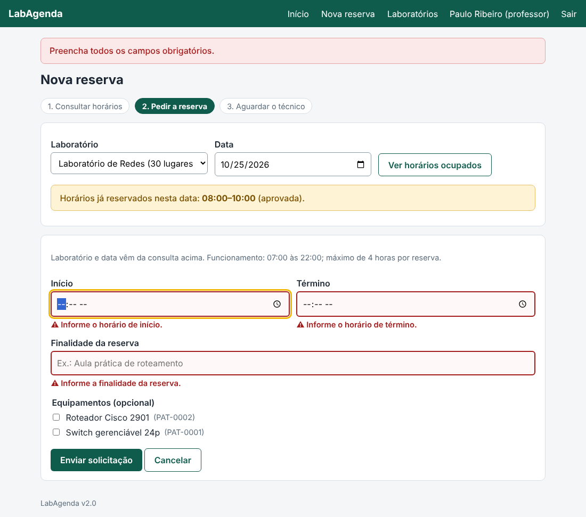
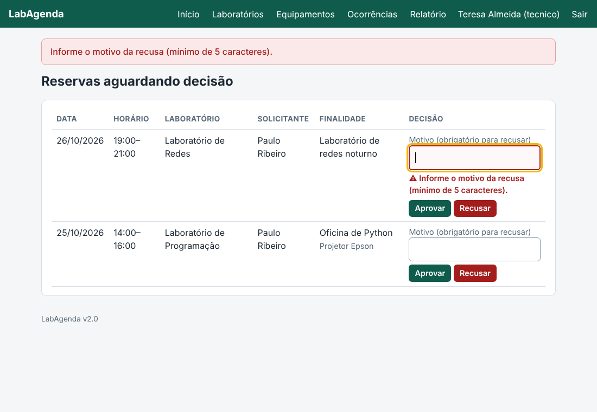
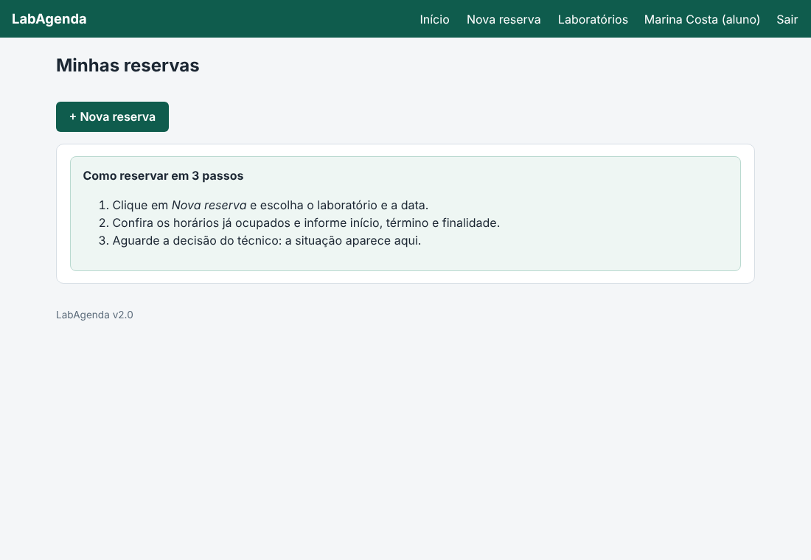

# 8. Feedback dos colegas e versão 2.0

A versão testada pelos colegas foi a **v1.0** (tag `v1.0` no Git). As melhorias abaixo compõem a **v2.0** (tag `v2.0`).

## 8.1 Respostas recebidas (transcrição)
As respostas estão transcritas na tabela de testes do documento Word. Resumo do que cada colega apontou:

| Colega | Foco | Funcionou | Apontou como problema | Não conseguiu confirmar |
|---|---|---|---|---|
| 1 | Cadastro e acesso | Cadastro válido, login e painel "Minhas reservas" | Mensagens pouco claras com **campos vazios** e **e-mail inválido** | Todas as validações do cadastro; bloqueio do painel após sair |
| 2 | Reservas e conflitos | Reserva válida fica pendente | Verificar conflito, limite de 4 h e horário de funcionamento | Liberação do horário após cancelar; reservas consecutivas |
| 3 | Painel do técnico | Visualizar pendentes | Verificar recusa sem justificativa e **confirmação** de aprovar/recusar | Motivo visível ao solicitante; bloqueio do relatório a alunos |
| 4 | Laboratórios, equipamentos, ocorrências | Gestão e ocorrências previstas | Verificar capacidade zero, duplicidades e laboratório desativado | Ocorrência em reserva já iniciada; relatório mensal |
| 5 | Usabilidade e celular | Navegação e compreensão das etapas | Verificar tabelas no celular, foco do teclado e mensagens que ensinam a corrigir | Tempo da 1ª reserva; nota de usabilidade |

## 8.2 Análise
Só o Colega 1 descreveu um problema concreto. Reproduzi o ponto na v1.0: com campos vazios ou e-mail inválido o
sistema **mostrava um aviso no topo da página, mas não junto do campo com problema nem o destacava**. Concluí que a
queixa é legítima do ponto de vista de usabilidade (heurística "ajuda a reconhecer e corrigir erros").

Os demais colegas listaram itens a **verificar** ou **não confirmados**. Tratei cada um como item de checklist:
verifiquei o comportamento no código, escrevi um teste automatizado para o que ainda não tinha cobertura de ponta a
ponta (pelas telas) e melhorei a interface onde a experiência podia ficar mais clara.

## 8.3 Mudanças da v2.0
| # | Origem | Mudança | Arquivos principais | Teste |
|---|---|---|---|---|
| 1 | Colega 1 | **Erro ao lado do campo**: texto em vermelho com ícone, borda destacada, `aria-invalid`, `aria-describedby` e foco automático no primeiro campo com erro | `_campos.html`, `style.css`, `services.py`, `messages.py` | `test_login_vazio_marca_os_dois_campos`, `test_cadastro_erros_ao_lado_de_cada_campo`, `test_email_invalido_sozinho` |
| 2 | Colega 1 | Mensagens específicas: "Informe o e-mail.", "Informe a senha.", "Informe seu nome completo." | `services.py` | idem |
| 3 | Colega 1 | Confirmado por teste: depois de **Sair**, `/painel` volta ao login | — | `test_depois_de_sair_o_painel_exige_login` |
| 4 | Colega 2 | Mensagem de sucesso da reserva traz **laboratório, data e horário** | `routes.py`, `messages.py` (S02) | `test_mensagem_de_reserva_traz_detalhes` |
| 5 | Colega 2 | Campos vazios da reserva marcados um a um; erro de conflito aparece **no campo de horário** | `nova_reserva.html` | `test_reserva_sem_horario_marca_campos`, `test_erro_de_conflito_aparece_no_campo_de_horario` |
| 6 | Colegas 2 e 5 | Indicador de etapas (1. Consultar · 2. Pedir · 3. Aguardar) | `nova_reserva.html` | `test_tela_de_reserva_mostra_etapas` |
| 7 | Colega 3 | Confirmação de aprovar/recusar informa **número da reserva e nome do solicitante** | `routes.py`, `messages.py` (S03, S04) | `test_fluxo_completo` |
| 8 | Colega 3 | Recusa sem motivo mostra o erro **na linha da reserva** e mantém a reserva pendente | `painel_tecnico.html`, `routes.py` | `test_recusa_sem_motivo_mostra_erro_na_linha_certa` |
| 9 | Colega 3 | Confirmado por teste: solicitante vê o motivo da recusa; aluno é barrado em relatório, equipamentos e ocorrências | — | `test_solicitante_ve_motivo_da_recusa`, `test_aluno_nao_acessa_area_do_tecnico` |
| 10 | Colega 4 | Confirmado por teste: laboratório desativado some da tela de reserva; ocorrência só em reserva aprovada e já iniciada; relatório mensal | `laboratorios.html` (aviso) | `test_laboratorio_desativado_some_da_nova_reserva`, `test_ocorrencia_pela_tela_*`, `test_relatorio_mensal_na_tela_e_em_csv` |
| 11 | Colega 4 (relatório) | **Exportar relatório em CSV** (abre direto no Excel, com proteção contra injeção de fórmula) — antes era pendência P05 | `routes.py`, `relatorio.html` | `test_csv_neutraliza_formula` |
| 12 | Colega 1 (acesso) | **Bloqueio após 5 senhas erradas** por 10 minutos (E25) — antes pendência P03 | `services.py` | `test_bloqueio_apos_cinco_senhas_erradas` |
| 13 | Colega 5 | Link "Pular para o conteúdo", versão do sistema no rodapé, cookie `Secure` configurável (`SECURE_COOKIES=1`, pendência P02) | `base.html`, `__init__.py` | `test_pagina_tem_link_de_salto_foco_e_idioma` |
| 14 | Colega 5 | **Ajuda na primeira visita**: painel vazio explica como reservar em 3 passos | `painel.html` | `test_painel_vazio_ensina_a_reservar` |

**Resultado dos testes:** 25 (v1.0) → **44 testes automatizados**, todos aprovados.

## 8.4 Capturas da v2.0
| Melhoria | Imagem |
|---|---|
| Login com campos vazios |  |
| Reserva com campos vazios |  |
| Recusa sem motivo na linha da reserva |  |
| Painel vazio com ajuda |  |

## 8.5 Limitações conhecidas da v2.0
- O bloqueio de tentativas fica na memória do processo: serve para um servidor simples; com vários processos use Redis ou uma tabela no banco.
- O roteiro foi executado depois contra o MySQL real da implantação (ver seção 5.6 do laudo).
- Itens que os colegas não conseguiram confirmar e dependem de **medição humana** (tempo da 1ª reserva, nota de usabilidade) só podem ser obtidos em um novo teste com pessoas.

## 8.6 Melhorias do autor (v2.1, v2.2 e v2.2.1)
Não vieram do teste dos colegas: surgiram quando o próprio autor usou o sistema para gravar a demonstração e percebeu lacunas. Entram no ciclo Kaizen como melhorias de segunda rodada.

| Versão | Melhoria | Motivo |
|---|---|---|
| 2.1 | **Exclusão lógica** de equipamentos e laboratórios, com motivo, data e responsável; tela **Itens excluídos** com abas e botão **Reativar** | Marcar como "indisponível" deixava itens fora de uso na lista para sempre; era preciso manter o histórico |
| 2.2 | **Histórico de alterações** (cadastro, edição, situação, exclusão, reativação, manutenção) | Saber quem mudou o quê |
| 2.2 | **Edição de equipamentos** (nome, patrimônio, laboratório) | Corrigir erro de digitação sem recadastrar |
| 2.2 | **Ocorrência ligada ao equipamento**, com envio para manutenção | A tela não permitia escolher o equipamento |
| 2.2 | **Filtros e busca**: reservas do técnico, equipamentos e histórico | Listas crescem com o uso |
| 2.2.1 | Opção **"Problema geral do laboratório"** nas ocorrências (fiação, ar-condicionado…) | Nem toda ocorrência envolve um equipamento |

Testes: 44 → **78 testes automatizados**.

## 8.7 Próximo ciclo Kaizen
1. Notificação por e-mail quando a reserva for decidida (depende de serviço externo).
2. Recuperação de senha.
3. Calendário semanal visual.
4. Repetir o teste com os mesmos colegas, **medindo** tempo da primeira reserva e nota de 1 a 5.
